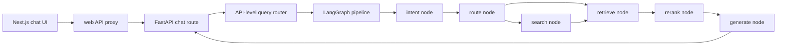
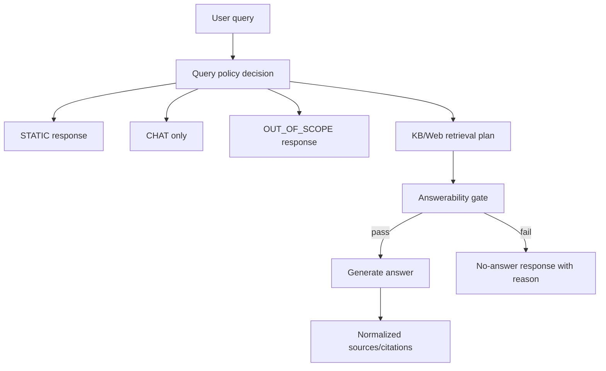

# Implementation Plan: RAG Logic Enhancement

**Date:** 2026-05-31
**Status:** Implemented
**Owner:** AI agent handoff plan

## Objective

Make the RAG pipeline predictable for out-of-domain, no-DB-source, weak-search,
and streaming cases by introducing explicit decision states and a pre-generation
answerability gate.

## Pre-Implementation Request Flow



## Implemented Decision Flow



## Dependency Graph

```text
Layer 0: Step 1
Layer 1: Step 2, Step 3
Layer 2: Step 4
Layer 3: Step 5
Layer 4: Step 6
Layer 5: Step 7
```

Steps 2 and 3 can run in parallel after Step 1 if agents coordinate file overlap.

---

## Step 1: Repair Blockers And Contracts

### Context Brief

Before architecture changes, the project must import and route without immediate
runtime errors. Known issues from review:

- `agent/citation_validator.py` has an indentation syntax error.
- `api/routes/chat.py` reads `request.search_source`, but `api/models.py`
  does not define it.
- `api/routes/chat.py` passes `search_source` to `run_agent_graph`, but
  `agent/pipeline.py::run_agent_graph` does not accept it.
- `tests/test_query_router.py` appears stale: it imports `QueryRouter`, while
  current code defines `EmbeddingQueryRouter`.

### Task List

- [x] Fix `agent/citation_validator.py` indentation.
- [x] Add a typed `search_source` field to `ChatRequest`.
- [x] Add `search_source` to `run_agent_graph`, `_default_state`, and
      `AgentState` usage.
- [x] Update stale query router tests to match the current router or split pure
      rule tests from embedding/Chroma integration tests.

### Verification

```bash
python -m py_compile agent/citation_validator.py api/models.py agent/pipeline.py
pytest tests/test_stage2_intent.py -q
pytest tests/test_query_router.py -q
```

### Exit Criteria

- [x] Imports no longer fail at test collection.
- [x] `search_source` can round-trip from frontend body to agent state.
- [x] Query router tests reflect current code.

### Rollback

Revert only the files touched in this step and restore the previous failing
behavior if a wider refactor starts to leak in.

### Dependencies

- Depends on: none
- Blocks: all later steps

---

## Step 2: Introduce Query Policy Model

### Context Brief

The current system has two routing layers:

- API-level `RouteType`: `STATIC | LLM_ONLY | RAG`
- Graph-level `route_type`: `kb_only | search | both | search_only`

These should not be collapsed blindly, but the system needs one explicit policy
object that says what kind of answer is allowed.

### Task List

- [x] Create a small query policy model with decisions:
      `STATIC`, `CHAT`, `OUT_OF_SCOPE`, `KB_ONLY`, `SEARCH_ONLY`, `HYBRID`,
      `CLARIFY`.
- [x] Include `reason`, `confidence`, `source_policy`, and `answer_policy`.
- [x] Keep static greeting/thanks/farewell fast paths.
- [x] Add out-of-domain detection for clearly unrelated queries.
- [x] Preserve manual UI modes: `auto`, `search`, `chat`.

### Verification

```bash
pytest tests/test_query_router.py -q
pytest tests/test_query_policy.py -q
```

### Exit Criteria

- [x] Out-of-domain queries do not enter RAG by default.
- [x] In-domain queries can still reach KB/search/hybrid.
- [x] Manual `chat` mode bypasses retrieval.
- [x] Manual `search` mode forces retrieval without bypassing answerability.

### Rollback

Keep the existing `get_router()` behavior behind a fallback path until policy
tests pass. If the policy model misroutes too much, switch API routes back to
the existing router while retaining tests as pending work.

### Dependencies

- Depends on: Step 1
- Blocks: Step 4, Step 5

---

## Step 3: Normalize Source And Citation Shape

### Context Brief

`generate_node` currently stores validator output as strings, while API and
streaming code expect citation dictionaries. This causes source display and
metadata loss.

### Task List

- [x] Define one source shape: `id`, `title`, `url`, `source_type`, `score`,
      `snippet`, `published_at`, `alive_status`.
- [x] Convert KB snippets, arXiv results, and Tavily results into that shape.
- [x] Make citation validation annotate sources rather than replace them.
- [x] Update API response formatting and streaming `source-url` events to use
      the same source list.

### Verification

```bash
pytest tests/test_citation_validator.py -q
pytest tests/test_chat_contract.py -q
```

### Exit Criteria

- [x] API citations and streaming sources use the same canonical source shape.
- [x] Missing/invalid URL does not crash formatting.
- [x] Source metadata survives retrieval, generation, and API response.

### Rollback

Keep a compatibility adapter that can accept old string citations until all
callers are migrated.

### Dependencies

- Depends on: Step 1
- Blocks: Step 4, Step 6

---

## Step 4: Add Answerability Gate

### Context Brief

Generation should only run when evidence is strong enough. Low KB confidence,
negative rerank scores, empty snippets, and weak web search should produce a
controlled no-answer response, not a best-effort answer.

### Task List

- [x] Add `answerability` state with: `can_answer`, `reason`, `evidence_count`,
      `top_score`, `source_mix`, and `recommended_action`.
- [x] Gate generation after retrieval/rerank.
- [x] Distinguish no-answer reasons:
      `OUT_OF_SCOPE`, `NO_KB_MATCH`, `NO_SEARCH_RESULTS`, `WEAK_EVIDENCE`,
      `INFRA_ERROR`, `NEEDS_CLARIFICATION`.
- [x] Return a user-facing message that explains the next useful action.

### Verification

```bash
pytest tests/test_answerability.py -q
pytest tests/test_stage2_graph.py -q
```

### Exit Criteria

- [x] Out-of-domain queries return out-of-scope responses.
- [x] In-domain but missing-DB queries return a no-source response or search
      suggestion.
- [x] Weak rerank results do not silently generate.
- [x] Valid RAG queries still generate with citations.

### Rollback

Tune the gate with `ANSWERABILITY_MIN_RERANK_SCORE` (default `-8.0`). If
behavior is too strict, lower thresholds while preserving reason reporting.

### Dependencies

- Depends on: Step 2, Step 3
- Blocks: Step 5, Step 6

---

## Step 5: Split Retrieval From Generation For Streaming

### Context Brief

The streaming endpoint runs `run_agent_graph`, whose graph already includes
`generate`, then calls `stream_answer` again. This can double latency/cost and
produce different streamed vs stored answers.

### Task List

- [x] Add a retrieve-only graph or a pipeline flag that stops after
      answerability.
- [x] Make streaming call retrieve/answerability once, then stream generation
      once.
- [x] Make non-streaming reuse the same retrieval and answerability path.
- [x] Store exactly the answer shown to the user in conversation memory.

### Verification

```bash
pytest tests/test_chat_streaming.py -q
pytest tests/test_stage2_graph.py -q
```

### Exit Criteria

- [x] Streaming path performs one LLM generation.
- [x] Non-streaming and streaming share routing/retrieval behavior.
- [x] Memory stores the displayed answer.

### Rollback

Retain the current non-streaming `/api/chat` path while changing only
`/api/chat/stream`; revert the streaming route if protocol compatibility breaks.

### Dependencies

- Depends on: Step 4
- Blocks: Step 6

---

## Step 6: Add Edge-Case Test Matrix

### Context Brief

The current tests do not reliably protect out-of-domain and missing-source
behavior. Some tests are stale or rely on heavy model dependencies during unit
collection.

### Task List

- [x] Add pure unit tests with mocked embeddings/retrieval.
- [x] Cover table cases:
      greeting, chitchat, out-of-domain, in-domain empty DB, weak KB, search
      failed, search weak, all rerank scores negative, manual chat, manual
      search, valid KB answer.
- [x] Keep model-loading tests separate and optional.
- [x] Add API contract tests for `ChatRequest`, `search_source`, and citations.

### Verification

```bash
pytest tests/test_query_policy.py tests/test_answerability.py tests/test_chat_contract.py -q
pytest tests/ -q
```

### Exit Criteria

- [x] Unit tests do not require downloading sentence-transformer models.
- [x] Edge cases are explicit and readable.
- [x] Existing RAG happy path remains covered.

### Rollback

If full suite is unstable, keep new tests isolated and mark model-dependent
integration tests with a clear pytest marker.

### Dependencies

- Depends on: Step 5
- Blocks: Step 7

---

## Step 7: Documentation And Handoff Update

### Context Brief

Future agents need one source of truth for the new policy, answerability, and
source model. Update project docs after behavior stabilizes.

### Task List

- [x] Update `CLAUDE.md` architecture notes.
- [x] Update this folder's `CHECKLOG.md` with final decisions.
- [x] Document new env flags and thresholds.
- [x] Add a short troubleshooting section for no-answer outcomes.

### Verification

```bash
python -m py_compile agent/**/*.py api/**/*.py
pytest tests/ -q
```

### Exit Criteria

- [x] Docs match code behavior.
- [x] A fresh agent can understand where to change policy, retrieval, and
      answerability.
- [x] No unresolved plan items remain undocumented.

### Rollback

If implementation diverges from this plan, update the plan and checklog rather
than forcing code to match stale docs.

### Dependencies

- Depends on: Step 6
- Blocks: none

---

## Adversarial Review Notes

- Do not treat low KB confidence as a direct synonym for fresh search.
- Do not generate from search snippets unless answerability passes.
- Do not let streaming and non-streaming maintain separate logic.
- Do not let citation validation change the public source shape.
- Do not require real embedding models for pure unit tests.
