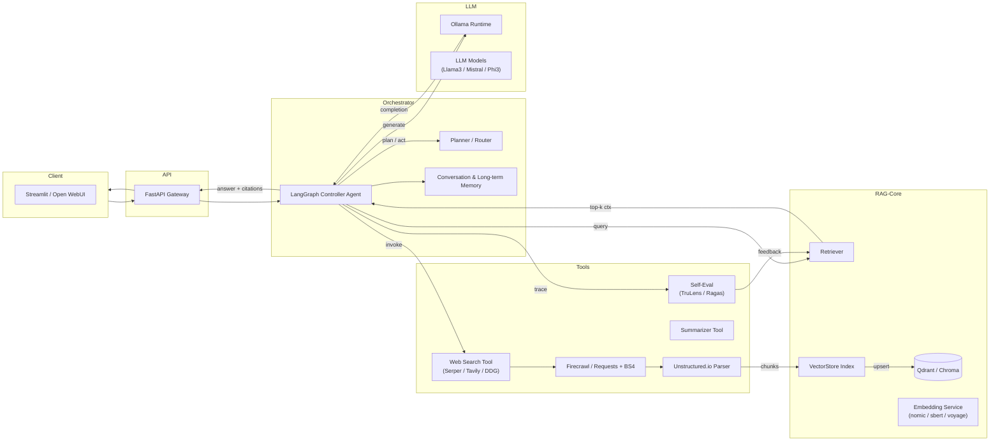
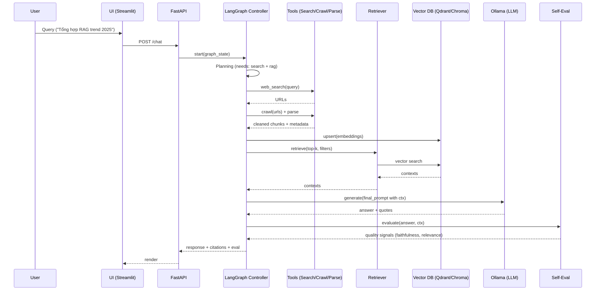
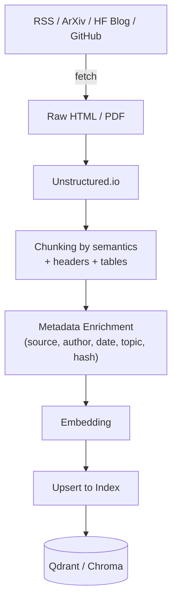
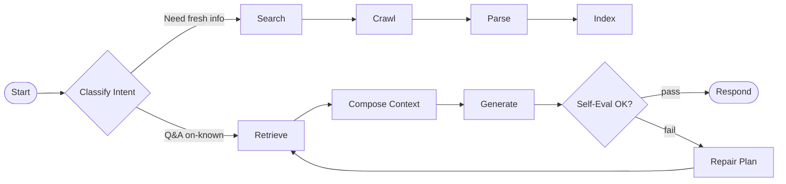
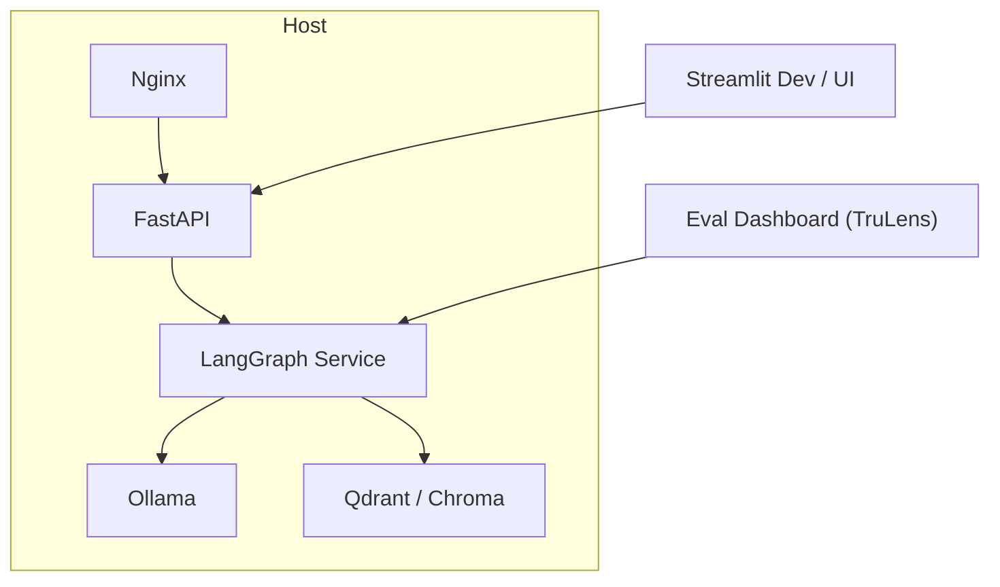

# AI Research Companion Agent – Architecture (Ollama + Agentic RAG)

> Mục tiêu: Agent tự tìm kiếm, đọc, tóm tắt, lưu tri thức vào vector DB, trả lời bằng RAG, có kế hoạch nhiều bước (LangGraph) và self-eval.
>

---

## 1) High-level Component Diagram



---

## 2) Request Lifecycle (Sequence)



---

## 3) Data Ingestion & Indexing



**Chunking gợi ý**

- Rule: 512–1024 tokens, overlap 50–100 tokens.
- Split theo tiêu đề (H1–H3), bảng/ảnh có caption lưu riêng.
- Metadata: `source_url`, `published_at`, `retrieved_at`, `content_hash`, `language`, `doc_type`.

---

## 4) LangGraph Node Design



**Node responsibilities**

- **Intent**: route theo intent (known vs fresh vs mixed).
- **Search**: multi-query search, dedup URL.
- **Crawl/Parse**: chuẩn hoá văn bản, trích ảnh/bảng/caption.
- **Index**: upsert có versioning (content_hash) & TTL.
- **Retrieve**: hybrid search (dense + keyword BM25), re-rank.
- **Generate**: prompt với citations + guardrails.
- **Eval**: faithfulness, answer relevance, context precision.
- **Repair**: tăng k, đổi query, hoặc back-off model.

---

## 5) Tech Stack Mapping

| Layer | Choice | Notes |
| --- | --- | --- |
| LLM Runtime | **Ollama** | self-host, swap model dễ qua `litellm` |
| Orchestration | **LangGraph** | graph-based agents, deterministic control |
| RAG Framework | **LlamaIndex** | `VectorStoreIndex`, `QueryEngine`, Agents |
| Vector DB | **Qdrant** (prod) / **Chroma** (dev) | metadata-rich, HNSW/IVF |
| Embeddings | **nomic-embed-text** / sbert | tiếng Việt tốt; dễ self-host |
| Search | **Serper/Tavily/DDG** | thay thế được, cacheable |
| Crawl/Parse | **Firecrawl**, **Unstructured.io** | PDF/HTML robust |
| Eval | **TruLens** / **Ragas** | faithfulness, answer quality |
| API/UI | **FastAPI** + **Streamlit/Open WebUI** | nhanh dựng demo |

---

## 6) Storage & Schemas

**Qdrant/Chroma collection** `knowledge_base`:

- `id`: UUID (content_hash)
- `vector`: float[]
- `payload`:
    - `source_url`: str
    - `title`: str
    - `published_at`: datetime
    - `retrieved_at`: datetime
    - `language`: "vi" | "en"
    - `doc_type`: "blog" | "paper" | "doc" | ...
    - `section`: H path (H1/H2/H3)
    - `tags`: [str]
    - `ttl`: int (secs) — optional

**Memory store** `agent_memory`:

- `session_id`, `role`, `content`, `ts`, `vector` (optional for semantic recall)

---

## 7) Retrieval Strategy (Hybrid & Re-Ranking)

1. **Hybrid Search** = Dense (cosine) + BM25 keyword → merge by reciprocal rank fusion.
2. **Time-aware Filtering**: prefer `published_at` gần hiện tại.
3. **Source Diversity**: cap tối đa N chunk/nguồn để tránh thiên lệch.
4. **Re-rank**: Cross-encoder (optional, nếu GPU OK) hoặc LLM re-rank lightweight.

---

## 8) Prompting Blocks (tóm tắt)

- **Planner Prompt**: quyết định tools và thứ tự.
- **Search Prompt**: sinh nhiều truy vấn (multi-query) từ 1 câu hỏi.
- **Synthesis Prompt**: hợp nhất snippet + đảm bảo citation.
- **Guardrails**: nếu thiếu dữ liệu, thừa nhận và đề xuất hành động (search lại, tăng k).

---

## 9) Self-Eval & Auto-Repair Loop

- **Metrics**: Faithfulness (hallucination), Context Precision/Recall, Answer Relevance.
- **Policy**: Nếu `faithfulness < τ` → kích hoạt `Repair`: tăng `k`, đổi truy vấn, nạp nguồn mới.
- **Logging**: lưu trace LangGraph + kết quả eval cho dashboard.

---

## 10) Deployment Topology



- **Scaling**:
    - Tách **Ollama** ra node riêng nếu GPU khác.
    - **Qdrant** có thể cluster; Chroma chạy local.
    - FastAPI scale bằng Uvicorn workers + autoscaling.

---

## 11) Config Snippets (rút gọn)

**Ollama model server**

```bash
ollama run llama3

```

**litellm (tuỳ chọn) config.yaml**

```yaml
model_list:
  - model_name: ollama/llama3
    litellm_params:
      model: ollama/llama3
      api_base: http://localhost:11434

```

**LlamaIndex – VectorStoreIndex** (pseudo)

```python
from llama_index import VectorStoreIndex, ServiceContext
from llama_index.embeddings import NomicEmbedding
from llama_index.vector_stores import QdrantVectorStore

svc = ServiceContext.from_defaults(embed_model=NomicEmbedding())
store = QdrantVectorStore(collection_name="knowledge_base", url="http://localhost:6333")
index = VectorStoreIndex.from_vector_store(store, service_context=svc)

```

**LangGraph skeleton** (pseudo)

```python
# Nodes: intent -> search -> crawl -> parse -> index -> retrieve -> generate -> eval -> (repair?)

```

---

## 12) Observability & Guardrails

- **Tracing**: LangGraph run logs + tool invocations.
- **Metrics**: latency, hit-rate của retriever, % repair, eval scores.
- **Rate limits**: cache kết quả search/crawl; exponential backoff.
- **PII**: sanitize trước khi index; filter domain không tin cậy.

---

## 13) Roadmap triển khai (4 chặng)

1. **MVP (Week 1–2)**: Search→Crawl→Parse→Index→Retrieve→Generate (Ollama + Chroma + Streamlit).
2. **Agent (Week 3–4)**: LangGraph planner + multi-query search + citations + memory.
3. **Quality (Week 5–6)**: TruLens/Ragas eval + auto-repair loop + hybrid search + re-rank.
4. **Prod (Week 7+)**: Qdrant, FastAPI gateway, caching, dashboard, scaling.

---

## 14) Testing Checklist

- ✅ Determinism: cùng input → plan tương đương.
- ✅ Freshness: ưu tiên tài liệu mới (kiểm tra `published_at`).
- ✅ Robustness: hỏng 1 tool → degrade gracefully.
- ✅ Faithfulness: không bịa; luôn hiển thị nguồn.
- ✅ Latency: P95 < 3–6s (tùy GPU/model).

---

**Tip**: giữ mọi lớp **thay thế được** (plug-and-play): model, embeddings, vector DB, search provider, eval. Đây là chìa khoá “chống lỗi thời”.
