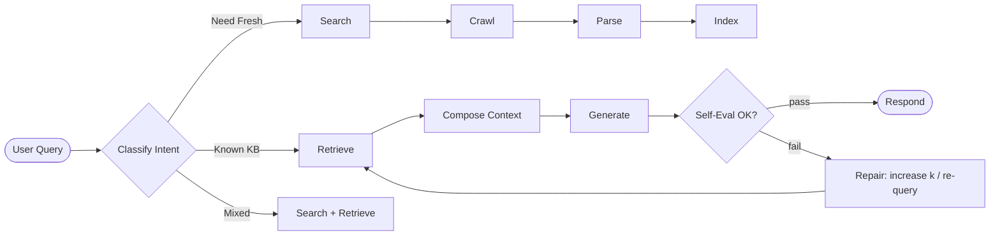

# 🧠 AI Research Agent — Stage 2: Agentic Orchestration

## 🎯 Mục tiêu (Definition of Done)

Chuyển từ pipeline tuyến tính sang **agentic system** với:
- **LangGraph orchestration**: quyết định tools và thứ tự động
- **Multi-query search**: sinh nhiều truy vấn từ 1 câu hỏi
- **Conversation memory**: lưu context giữa các lượt hỏi
- **Self-routing**: tự quyết định cần search mới hay dùng knowledge base hiện có

---

## 🏗️ 1. Kiến trúc LangGraph

### 📊 Graph Flow



### 🔧 Node Responsibilities

- **Intent Classifier**: route theo intent (known vs fresh vs mixed)
- **Search Node**: multi-query expansion (sinh 3–5 queries từ 1 question)
- **Retrieve Node**: hybrid search (dense + BM25 + RRF)
- **Generate Node**: Ollama với guardrail prompt
- **Eval Node**: self-evaluation (faithfulness, relevance) — optional ở stage 2
- **Repair Node**: tăng k, đổi query, hoặc back-off

### 📋 State Schema

**File:** `agent/state.py`

```python
from typing import TypedDict, List, Optional, Literal

class AgentState(TypedDict):
    """State schema for LangGraph StateGraph."""
    # Input
    query: str
    
    # Intent classification
    intent: Optional[Literal["known", "fresh", "mixed"]]
    intent_confidence: Optional[float]
    
    # Routing
    route_type: Optional[Literal["kb_only", "search", "both"]]
    kb_confidence: Optional[float]
    
    # Search
    expanded_queries: Optional[List[str]]
    search_results: Optional[List[Dict]]
    
    # Retrieval
    kb_snippets: Optional[List[Dict]]
    merged_snippets: Optional[List[Dict]]
    
    # Generation
    answer: Optional[str]
    citations: Optional[List[str]]
    
    # Memory
    memory_context: Optional[str]
    
    # Error handling
    error: Optional[str]
```

### 🔗 Graph Definition Example

**File:** `agent/graph.py`

```python
from langgraph.graph import StateGraph, END
from agent.state import AgentState

def create_graph():
    """Create and compile LangGraph."""
    graph = StateGraph(AgentState)
    
    # Add nodes
    graph.add_node("intent", classify_intent_node)
    graph.add_node("route", route_query_node)
    graph.add_node("search", search_node)
    graph.add_node("retrieve", retrieve_node)
    graph.add_node("generate", generate_node)
    
    # Set entry point
    graph.set_entry_point("intent")
    
    # Add edges
    graph.add_edge("intent", "route")
    
    # Conditional routing based on route_type
    graph.add_conditional_edges(
        "route",
        route_decision,  # Function that returns next node name
        {
            "kb_only": "retrieve",
            "search": "search",
            "both": "search"  # Will merge with retrieve later
        }
    )
    
    # After search, always retrieve (and merge if needed)
    graph.add_edge("search", "retrieve")
    graph.add_edge("retrieve", "generate")
    graph.add_edge("generate", END)
    
    return graph.compile()

def route_decision(state: AgentState) -> str:
    """Determine next node based on route_type."""
    route = state.get("route_type", "search")
    return route
```

---

## 📦 2. Tech Stack Additions

| Component | Choice | Notes |
| --- | --- | --- |
| Orchestration | **LangGraph** | graph-based agents, deterministic control |
| Memory | **LangChain Memory** / SQLite | conversation history + optional semantic recall |
| Multi-query | **LLM-based expansion** | Ollama sinh queries từ question |

---

## 🗂️ 3. Implementation Plan

### Phase 1: LangGraph Setup (Week 1)

1. **Install dependencies**
   ```bash
   pip install langgraph>=0.2.0 langchain>=0.3.0 langchain-community>=0.3.0
   ```
   
   **Note:** Pin versions trong `requirements.txt`:
   ```txt
   langgraph==0.2.0
   langchain==0.3.0
   langchain-community==0.3.0
   ```

2. **Create graph structure**
   - `agent/graph.py`: define nodes và edges
   - `agent/state.py`: StateGraph state schema
   - `agent/nodes/`: tách nodes thành modules

3. **Intent classifier node**
   - Input: user query
   - Output: intent (known/fresh/mixed) + confidence score
   - Method: Hybrid (rule-based first, LLM fallback)

### Phase 2: Multi-query Search (Week 1–2)

1. **Query expansion**
   - Sử dụng LLM để sinh nhiều queries từ 1 question
   - Dedup queries tương tự (cosine similarity > 0.9)
   - Merge results với priority scoring

2. **Parallel search**
   - Chạy nhiều queries song song (concurrent.futures)
   - Merge results (dedup URLs)
   - Ưu tiên relevance score

### Phase 3: Memory Integration (Week 2)

1. **Conversation memory**
   - Schema: `(user_query, answer, citations, timestamp, query_embedding)`
   - Storage: SQLite hoặc in-memory dict với LRU eviction
   - Optional: semantic search trong history (embed queries, cosine similarity)

2. **Context injection**
   - Nếu câu hỏi liên quan đến câu trước (similarity > 0.7) → inject previous context
   - Tránh lặp lại thông tin đã nói
   - Format: "Previous context: [previous_answer]"

### Phase 4: Self-Routing (Week 2–3)

1. **Knowledge base check**
   - Trước khi search, check KB có đủ context không
   - Nếu có → skip search, chỉ retrieve
   - Nếu không → search → crawl → index → retrieve

2. **Confidence scoring**
   - Retrieve confidence = mean(top_k_similarity_scores)
   - Threshold: confidence < 0.7 → trigger search
   - Fallback: nếu search fail → dùng KB dù confidence thấp

---

## 📋 4. File Structure

```
agent/
├── graph.py              # LangGraph definition
├── state.py              # StateGraph state schema
├── nodes/
│   ├── intent.py         # Intent classification
│   ├── search.py         # Multi-query search
│   ├── retrieve.py       # Hybrid retrieval
│   ├── generate.py       # LLM generation
│   └── eval.py           # Self-evaluation (optional)
├── memory/
│   ├── conversation.py   # Conversation history
│   └── semantic.py       # Semantic recall (optional)
└── router.py             # Self-routing logic
```

---

## ✅ 5. Success Criteria

- [ ] LangGraph chạy end-to-end với intent routing
- [ ] Multi-query search sinh 3–5 queries và merge results
- [ ] Conversation memory lưu và recall được context
- [ ] Self-routing: tự quyết định search vs retrieve-only
- [ ] Tests: 5–10 scenarios với mixed intents

---

## 🔄 6. Migration từ Stage 1

- Giữ nguyên ingestion pipeline (`ingest/*`)
- Giữ nguyên retrieval logic (`agent/retriever.py`)
- Wrap existing functions vào LangGraph nodes
- Thêm memory layer trên cùng

---

## 📊 7. Metrics & Observability

### Metrics to Track

- **Graph execution time**: từng node duration (ms)
- **Routing decisions**: % search vs retrieve-only vs mixed
- **Memory hit rate**: % queries có context từ history
- **Multi-query effectiveness**: số queries sinh ra, merge quality
- **Confidence scores**: distribution của KB confidence
- **Error rates**: timeout, API failures, parse errors

### Collection Strategy

1. **LangGraph Callbacks**
   ```python
   from langgraph.callbacks import CallbackHandler
   
   class MetricsCallback(CallbackHandler):
       def on_node_start(self, node_name):
           self.start_time = time.time()
       
       def on_node_end(self, node_name):
           duration = time.time() - self.start_time
           log_metric(f"node.{node_name}.duration_ms", duration * 1000)
   ```

2. **Structured Logging**
   - JSON logs cho mỗi graph execution
   - Fields: `timestamp`, `node`, `duration_ms`, `input_size`, `output_size`
   - Export to file hoặc stdout

3. **Streamlit Dashboard** (optional)
   - Real-time metrics visualization
   - Node duration charts
   - Routing decision pie chart
   - Memory hit rate over time

---

## 🔧 8. Implementation Details

### 8.1 Multi-query Expansion

**Prompt Template:**
```python
MULTI_QUERY_PROMPT = """
Từ câu hỏi sau, sinh 3-5 truy vấn tìm kiếm khác nhau để tìm thông tin liên quan.
Mỗi truy vấn nên có góc nhìn hoặc từ khóa khác nhau.

Câu hỏi: {question}

Trả về danh sách truy vấn, mỗi dòng một truy vấn:
"""
```

**Implementation:**
```python
def expand_query(question: str, model: str = "llama3") -> List[str]:
    prompt = MULTI_QUERY_PROMPT.format(question=question)
    response = call_ollama(prompt, model=model)
    
    # Parse response (mỗi dòng một query)
    queries = [q.strip() for q in response.strip().split("\n") if q.strip()]
    
    # Dedup similar queries (cosine similarity > 0.9)
    queries = dedup_queries(queries, threshold=0.9)
    
    # Limit to 5 queries max
    return queries[:5]

def dedup_queries(queries: List[str], threshold: float = 0.9) -> List[str]:
    """Remove similar queries using embedding similarity."""
    if len(queries) <= 1:
        return queries
    
    model = get_embed_model()
    embeddings = model.encode(queries)
    
    # Compute pairwise cosine similarity
    unique_queries = [queries[0]]
    for q, emb in zip(queries[1:], embeddings[1:]):
        similarities = [
            cosine_similarity(emb, model.encode([uq])[0])
            for uq in unique_queries
        ]
        if max(similarities) < threshold:
            unique_queries.append(q)
    
    return unique_queries
```

**Parallel Search:**
```python
from concurrent.futures import ThreadPoolExecutor, as_completed

def parallel_search(queries: List[str], max_results: int = 5) -> List[Dict]:
    """Search multiple queries in parallel and merge results."""
    all_results = []
    
    with ThreadPoolExecutor(max_workers=5) as executor:
        futures = {
            executor.submit(search_arxiv, q, max_results): q
            for q in queries
        }
        
        for future in as_completed(futures):
            try:
                results = future.result()
                all_results.extend(results)
            except Exception as e:
                log_error(f"Search failed for query: {futures[future]}: {e}")
    
    # Dedup by URL
    seen_urls = set()
    unique_results = []
    for r in all_results:
        url = r.get("abs_url") or r.get("pdf_url", "")
        if url and url not in seen_urls:
            seen_urls.add(url)
            unique_results.append(r)
    
    # Sort by relevance (if available) or keep original order
    return unique_results[:max_results * len(queries)]
```

### 8.2 Intent Classifier

**Rule-based First:**
```python
FRESH_KEYWORDS = ["mới nhất", "latest", "2025", "2024", "recent", "new"]
KNOWN_KEYWORDS = ["so sánh", "compare", "khác nhau", "difference", "ưu nhược"]

def classify_intent_rule(query: str) -> Tuple[str, float]:
    """Rule-based intent classification."""
    query_lower = query.lower()
    
    has_fresh = any(kw in query_lower for kw in FRESH_KEYWORDS)
    has_known = any(kw in query_lower for kw in KNOWN_KEYWORDS)
    
    if has_fresh and has_known:
        return "mixed", 0.8
    elif has_fresh:
        return "fresh", 0.9
    elif has_known:
        return "known", 0.9
    else:
        return "unknown", 0.5  # Need LLM fallback
```

**LLM Fallback:**
```python
INTENT_CLASSIFY_PROMPT = """
Phân loại intent của câu hỏi sau:
- "known": câu hỏi về kiến thức đã có trong knowledge base
- "fresh": cần thông tin mới nhất (2024-2025, latest trends)
- "mixed": kết hợp cả hai

Câu hỏi: {query}

Trả về chỉ một từ: known, fresh, hoặc mixed
"""

def classify_intent_llm(query: str) -> Tuple[str, float]:
    """LLM-based intent classification."""
    prompt = INTENT_CLASSIFY_PROMPT.format(query=query)
    response = call_ollama(prompt, temperature=0.1).strip().lower()
    
    if "fresh" in response:
        return "fresh", 0.8
    elif "mixed" in response:
        return "mixed", 0.7
    else:
        return "known", 0.8
```

**Hybrid Classifier:**
```python
def classify_intent(query: str) -> Tuple[str, float]:
    """Hybrid intent classification: rule-based first, LLM fallback."""
    intent, confidence = classify_intent_rule(query)
    
    if confidence < 0.7:  # Low confidence, use LLM
        intent, confidence = classify_intent_llm(query)
    
    return intent, confidence
```

### 8.3 Memory Schema

**Conversation Memory Schema:**
```python
from dataclasses import dataclass
from typing import List, Optional
import time

@dataclass
class ConversationEntry:
    query: str
    answer: str
    citations: List[str]
    timestamp: int
    query_embedding: Optional[List[float]] = None
    
    def to_dict(self) -> dict:
        return {
            "query": self.query,
            "answer": self.answer,
            "citations": self.citations,
            "timestamp": self.timestamp,
            "query_embedding": self.query_embedding,
        }
```

**Memory Storage:**
```python
from collections import OrderedDict
from typing import Dict, List

class ConversationMemory:
    def __init__(self, max_size: int = 50):
        self.memory: OrderedDict[str, ConversationEntry] = OrderedDict()
        self.max_size = max_size
        self.embed_model = get_embed_model()
    
    def add(self, query: str, answer: str, citations: List[str]):
        """Add conversation entry with LRU eviction."""
        query_emb = self.embed_model.encode([query])[0].tolist()
        entry = ConversationEntry(
            query=query,
            answer=answer,
            citations=citations,
            timestamp=int(time.time()),
            query_embedding=query_emb,
        )
        
        # LRU eviction
        if len(self.memory) >= self.max_size:
            self.memory.popitem(last=False)  # Remove oldest
        
        self.memory[query] = entry
    
    def search_similar(self, query: str, top_k: int = 3) -> List[ConversationEntry]:
        """Semantic search in conversation history."""
        if not self.memory:
            return []
        
        query_emb = self.embed_model.encode([query])[0]
        
        similarities = []
        for entry in self.memory.values():
            if entry.query_embedding:
                sim = cosine_similarity(
                    query_emb,
                    np.array(entry.query_embedding)
                )
                similarities.append((sim, entry))
        
        # Sort by similarity, return top-k
        similarities.sort(key=lambda x: x[0], reverse=True)
        return [entry for _, entry in similarities[:top_k]]
```

**Context Injection:**
```python
def inject_memory_context(query: str, memory: ConversationMemory) -> str:
    """Inject relevant previous context into query."""
    similar_entries = memory.search_similar(query, top_k=2)
    
    if not similar_entries:
        return query
    
    context_parts = []
    for entry in similar_entries:
        context_parts.append(
            f"Previous Q: {entry.query}\nPrevious A: {entry.answer[:200]}..."
        )
    
    context = "\n\n".join(context_parts)
    enhanced_query = f"{query}\n\n[Previous context for reference:]\n{context}"
    
    return enhanced_query
```

### 8.4 Self-Routing Logic

**Confidence Calculation:**
```python
def calculate_kb_confidence(
    query: str,
    chroma_collection,
    embed_model,
    k: int = 6
) -> Tuple[float, List[Dict]]:
    """Calculate KB confidence based on retrieval similarity scores."""
    query_emb = embed_model.encode([query])[0].tolist()
    
    res = chroma_collection.query(
        query_embeddings=[query_emb],
        n_results=k,
        include=["metadatas", "distances"]
    )
    
    distances = (res.get("distances") or [[]])[0]
    if not distances:
        return 0.0, []
    
    # Convert distances to similarities (1 - distance for cosine)
    similarities = [1.0 - d for d in distances]
    
    # Confidence = mean similarity
    confidence = sum(similarities) / len(similarities)
    
    # Build snippets for return
    docs = (res.get("documents") or [[]])[0]
    metas = (res.get("metadatas") or [[]])[0]
    snippets = [
        {"text": doc, "metadata": meta}
        for doc, meta in zip(docs, metas)
    ]
    
    return confidence, snippets
```

**Routing Decision:**
```python
CONFIDENCE_THRESHOLD = 0.7

def route_query(
    query: str,
    intent: str,
    chroma_collection,
    embed_model
) -> Tuple[str, List[Dict]]:
    """
    Route query based on intent and KB confidence.
    Returns: (route_type, snippets)
    - "kb_only": use KB only
    - "search": trigger search
    - "both": use both KB and search
    """
    # Calculate KB confidence
    kb_confidence, kb_snippets = calculate_kb_confidence(
        query, chroma_collection, embed_model
    )
    
    # Routing logic
    if intent == "fresh":
        return "search", []
    elif intent == "known":
        if kb_confidence >= CONFIDENCE_THRESHOLD:
            return "kb_only", kb_snippets
        else:
            return "search", []
    elif intent == "mixed":
        if kb_confidence >= CONFIDENCE_THRESHOLD:
            return "both", kb_snippets
        else:
            return "search", []
    else:
        # Unknown intent, default to search
        return "search", []
```

---

## ⚠️ 9. Error Handling

### 9.1 Ollama Errors

**Timeout Handling:**
```python
def call_ollama_with_fallback(prompt: str, max_retries: int = 2) -> str:
    """Call Ollama with retry and fallback."""
    for attempt in range(max_retries + 1):
        try:
            return call_ollama(prompt, timeout=120)
        except requests.Timeout:
            if attempt < max_retries:
                time.sleep(2 ** attempt)  # Exponential backoff
                continue
            else:
                # Fallback: return error message
                return "Xin lỗi, hệ thống đang quá tải. Vui lòng thử lại sau."
        except Exception as e:
            log_error(f"Ollama error: {e}")
            if attempt < max_retries:
                continue
            return "Xin lỗi, có lỗi xảy ra khi tạo câu trả lời."
```

**Model Not Found:**
```python
def ensure_model_available(model: str = "llama3"):
    """Check if Ollama model is available, pull if not."""
    try:
        resp = requests.get(f"{OLLAMA_BASE}/api/tags")
        models = [m["name"] for m in resp.json().get("models", [])]
        if model not in models:
            log_warning(f"Model {model} not found, pulling...")
            subprocess.run(["ollama", "pull", model], check=True)
    except Exception as e:
        log_error(f"Failed to check/pull model: {e}")
```

### 9.2 Search API Errors

**Search Failure Fallback:**
```python
def search_with_fallback(query: str) -> List[Dict]:
    """Search with fallback to KB-only if search fails."""
    try:
        return search_arxiv(query, max_results=5)
    except Exception as e:
        log_error(f"Search failed: {e}")
        # Fallback: use KB-only
        log_info("Falling back to KB-only retrieval")
        return []
```

### 9.3 Memory Errors

**Memory Full Handling:**
```python
class ConversationMemory:
    def add(self, query: str, answer: str, citations: List[str]):
        """Add with automatic LRU eviction."""
        try:
            # ... existing code ...
        except MemoryError:
            # Aggressive eviction: remove 50% oldest entries
            to_remove = len(self.memory) // 2
            for _ in range(to_remove):
                self.memory.popitem(last=False)
            # Retry
            self.memory[query] = entry
```

**Semantic Search Failure:**
```python
def search_similar(self, query: str, top_k: int = 3) -> List[ConversationEntry]:
    """Semantic search with error handling."""
    try:
        # ... existing code ...
    except Exception as e:
        log_error(f"Semantic search failed: {e}")
        # Fallback: return most recent entries
        return list(self.memory.values())[-top_k:]
```

### 9.4 Graph Cycle Detection

**Max Iterations:**
```python
from langgraph.graph import StateGraph

def create_graph():
    graph = StateGraph(State)
    
    # Add nodes and edges
    # ...
    
    # Compile with max iterations
    app = graph.compile(checkpointer=checkpointer)
    
    # In execution:
    config = {"configurable": {"thread_id": "1"}}
    max_iterations = 10
    
    try:
        result = app.invoke(input, config)
    except Exception as e:
        if "max_iterations" in str(e).lower():
            log_error("Graph cycle detected, aborting")
            return {"error": "Graph execution exceeded max iterations"}
        raise
```

### 9.5 ChromaDB Errors

**Connection Errors:**
```python
def get_chroma_collection_safe(chroma_path: str, retries: int = 3):
    """Get Chroma collection with retry."""
    for attempt in range(retries):
        try:
            client = chromadb.PersistentClient(path=chroma_path)
            return client.get_or_create_collection("knowledge_base")
        except Exception as e:
            if attempt < retries - 1:
                time.sleep(1)
                continue
            log_error(f"ChromaDB connection failed: {e}")
            raise
```

---

## 🧪 10. Testing Strategy

### 10.1 Unit Tests

**Intent Classifier Tests:**
```python
def test_intent_classifier_known():
    query = "So sánh RAG và fine-tuning"
    intent, confidence = classify_intent(query)
    assert intent == "known"
    assert confidence >= 0.7

def test_intent_classifier_fresh():
    query = "RAG trends 2025"
    intent, confidence = classify_intent(query)
    assert intent == "fresh"
    assert confidence >= 0.7

def test_intent_classifier_mixed():
    query = "So sánh RAG 2024 và 2025"
    intent, confidence = classify_intent(query)
    assert intent in ["mixed", "fresh"]
```

**Multi-query Expansion Tests:**
```python
def test_expand_query():
    question = "RAG techniques"
    queries = expand_query(question)
    assert len(queries) >= 3
    assert len(queries) <= 5
    assert all(isinstance(q, str) for q in queries)

def test_dedup_queries():
    queries = [
        "RAG techniques",
        "retrieval augmented generation methods",
        "RAG approaches"
    ]
    unique = dedup_queries(queries, threshold=0.9)
    assert len(unique) < len(queries)  # Should dedup similar ones
```

**Memory Tests:**
```python
def test_memory_lru_eviction():
    memory = ConversationMemory(max_size=3)
    for i in range(5):
        memory.add(f"query{i}", f"answer{i}", [])
    assert len(memory.memory) == 3
    assert "query0" not in memory.memory  # Should be evicted

def test_memory_semantic_search():
    memory = ConversationMemory()
    memory.add("RAG techniques", "RAG is...", [])
    memory.add("Python programming", "Python is...", [])
    
    similar = memory.search_similar("retrieval augmented generation", top_k=1)
    assert len(similar) == 1
    assert "RAG" in similar[0].query
```

### 10.2 Integration Tests

**End-to-end Graph Test:**
```python
from unittest.mock import Mock, patch

def test_graph_known_intent():
    """Test graph with known intent -> KB-only route."""
    with patch('agent.nodes.search.search_arxiv') as mock_search:
        input_state = {"query": "So sánh RAG và fine-tuning"}
        
        result = graph.invoke(input_state)
        
        # Should not call search
        mock_search.assert_not_called()
        
        # Should have answer
        assert "answer" in result
        assert len(result.get("citations", [])) >= 2

def test_graph_fresh_intent():
    """Test graph with fresh intent -> search route."""
    with patch('agent.nodes.search.search_arxiv') as mock_search:
        mock_search.return_value = [{"abs_url": "http://test.com"}]
        
        input_state = {"query": "RAG trends 2025"}
        
        result = graph.invoke(input_state)
        
        # Should call search
        mock_search.assert_called_once()
        
        # Should have answer
        assert "answer" in result
```

**Memory Integration Test:**
```python
def test_memory_context_injection():
    memory = ConversationMemory()
    memory.add("RAG là gì?", "RAG là...", [])
    
    query = "RAG có ưu điểm gì?"
    enhanced = inject_memory_context(query, memory)
    
    assert "Previous context" in enhanced
    assert "RAG là" in enhanced
```

### 10.3 Test Scenarios

**Scenario 1: Known Intent (KB-only)**
```python
test_case = {
    "query": "So sánh RAG và fine-tuning",
    "expected_route": "kb_only",
    "expected_citations": 2,
    "expected_search_calls": 0
}
```

**Scenario 2: Fresh Intent (Search)**
```python
test_case = {
    "query": "RAG trends 2025",
    "expected_route": "search",
    "expected_citations": 2,
    "expected_search_calls": 1
}
```

**Scenario 3: Mixed Intent (Both)**
```python
test_case = {
    "query": "So sánh RAG 2024 và 2025",
    "expected_route": "both",
    "expected_citations": 3,
    "expected_search_calls": 1
}
```

**Scenario 4: Low Confidence (Search Fallback)**
```python
test_case = {
    "query": "Very specific obscure topic",
    "expected_route": "search",  # Even if intent=known, low confidence triggers search
    "kb_confidence": 0.5,  # Below threshold
    "expected_search_calls": 1
}
```

**Scenario 5: Memory Recall**
```python
test_case = {
    "previous_query": "RAG là gì?",
    "previous_answer": "RAG là retrieval augmented generation...",
    "current_query": "RAG có ưu điểm gì?",
    "expected_memory_hit": True,
    "expected_context_injection": True
}
```

### 10.4 Performance Tests

**Latency Benchmarks:**
```python
def test_graph_latency():
    """Test graph execution time."""
    query = "RAG techniques"
    
    start = time.time()
    result = graph.invoke({"query": query})
    duration = time.time() - start
    
    # Should complete within reasonable time
    assert duration < 30.0  # 30 seconds max for known intent
    assert "answer" in result
```

**Concurrent Request Test:**
```python
def test_concurrent_requests():
    """Test handling multiple concurrent requests."""
    queries = [f"Query {i}" for i in range(5)]
    
    with ThreadPoolExecutor(max_workers=5) as executor:
        futures = [executor.submit(graph.invoke, {"query": q}) for q in queries]
        results = [f.result() for f in futures]
    
    assert all("answer" in r for r in results)
```

---

## 🔗 11. Integration với Stage 1 UI

### 11.1 Wrap Graph trong Function

**File:** `agent/pipeline.py`

```python
from agent.graph import create_graph
from agent.memory.conversation import ConversationMemory

# Initialize graph and memory (singleton pattern)
_graph = None
_memory = None

def get_graph():
    """Get or create graph instance."""
    global _graph
    if _graph is None:
        _graph = create_graph()
    return _graph

def get_memory():
    """Get or create memory instance."""
    global _memory
    if _memory is None:
        _memory = ConversationMemory(max_size=50)
    return _memory

def run_agent_graph(
    query: str,
    chroma_path: str = "./chroma",
    embed_model: str = "sentence-transformers/all-MiniLM-L6-v2"
) -> Dict:
    """
    Run agent graph end-to-end.
    Returns: {
        "answer": str,
        "citations": List[str],
        "route_type": str,
        "intent": str,
        "kb_confidence": float,
        "metrics": {...}
    }
    """
    graph = get_graph()
    memory = get_memory()
    
    # Inject memory context if available
    enhanced_query = inject_memory_context(query, memory)
    
    # Initial state
    initial_state = {
        "query": enhanced_query,
        "chroma_path": chroma_path,
        "embed_model": embed_model,
    }
    
    # Run graph
    result = graph.invoke(initial_state)
    
    # Save to memory
    if result.get("answer"):
        citations = result.get("citations", [])
        memory.add(query, result["answer"], citations)
    
    return {
        "answer": result.get("answer", ""),
        "citations": result.get("citations", []),
        "route_type": result.get("route_type", "unknown"),
        "intent": result.get("intent", "unknown"),
        "kb_confidence": result.get("kb_confidence", 0.0),
        "metrics": {
            "expanded_queries_count": len(result.get("expanded_queries", [])),
            "search_results_count": len(result.get("search_results", [])),
            "snippets_count": len(result.get("merged_snippets", [])),
        }
    }
```

### 11.2 Update Streamlit UI

**File:** `app/ui.py` - Update tab "Ask"

```python
from agent.pipeline import run_agent_graph

# In tab3 (Ask):
if st.button("Answer"):
    try:
        # Use agent graph instead of do_answer
        result = run_agent_graph(question, chroma_path, embed_model)
        
        # Display routing info
        col1, col2, col3 = st.columns(3)
        with col1:
            st.metric("Intent", result["intent"])
        with col2:
            st.metric("Route", result["route_type"])
        with col3:
            st.metric("KB Confidence", f"{result['kb_confidence']:.2f}")
        
        # Display metrics
        metrics = result.get("metrics", {})
        with st.expander("Execution Details"):
            st.write(f"Expanded queries: {metrics.get('expanded_queries_count', 0)}")
            st.write(f"Search results: {metrics.get('search_results_count', 0)}")
            st.write(f"Snippets used: {metrics.get('snippets_count', 0)}")
        
        # Display answer
        st.markdown("### Answer")
        st.write(result["answer"])
        
        # Display citations
        cit = result.get("citations", [])
        st.metric("Citations", len(cit))
        
    except Exception as exc:
        st.error(f"Answer failed: {exc}")
```

### 11.3 Memory Management trong UI

**Option 1: Session-based Memory (Simple)**
```python
# In app/ui.py
if "memory" not in st.session_state:
    from agent.memory.conversation import ConversationMemory
    st.session_state.memory = ConversationMemory(max_size=50)

# Use in run_agent_graph
result = run_agent_graph(question, memory=st.session_state.memory)
```

**Option 2: Persistent Memory (SQLite)**
```python
# In agent/memory/conversation.py
import sqlite3
from pathlib import Path

class PersistentConversationMemory(ConversationMemory):
    def __init__(self, db_path: str = "./cache/memory.db", max_size: int = 50):
        super().__init__(max_size)
        self.db_path = Path(db_path)
        self.db_path.parent.mkdir(parents=True, exist_ok=True)
        self._init_db()
        self._load_from_db()
    
    def _init_db(self):
        conn = sqlite3.connect(self.db_path)
        conn.execute("""
            CREATE TABLE IF NOT EXISTS conversations (
                query TEXT PRIMARY KEY,
                answer TEXT,
                citations TEXT,
                timestamp INTEGER,
                query_embedding BLOB
            )
        """)
        conn.close()
    
    def add(self, query: str, answer: str, citations: List[str]):
        super().add(query, answer, citations)
        self._save_to_db(query, answer, citations)
```

### 11.4 Backward Compatibility

**Giữ CLI scripts hoạt động:**
```python
# agent/answer.py - Update để dùng graph nếu có
def main():
    # ... existing argparse ...
    
    # Check if graph is available
    try:
        from agent.pipeline import run_agent_graph
        result = run_agent_graph(args.q, args.chroma, args.embed_model)
        print("\n=== Answer ===\n")
        print(result["answer"])
        print(f"\nRoute: {result['route_type']} | Intent: {result['intent']}")
    except ImportError:
        # Fallback to old pipeline
        # ... existing code ...
```

---

## 12. API Reference & Usage Examples

### 12.1 Python API (`run_agent_graph`)

```python
from agent.pipeline import run_agent_graph
from agent.memory import ConversationMemory

memory = ConversationMemory(max_size=50)

result = run_agent_graph(
    "Tóm tắt các tiến triển RAG 2024–2025",
    chroma_path="./chroma",
    embed_model="sentence-transformers/all-MiniLM-L6-v2",
    llm_backend="gemini",  # hoặc "ollama"
    memory=memory,
)

print(result["intent"], result["route_type"])
print(result["answer"])
```

- `result` trả về đầy đủ trường: `intent`, `route_type`, `kb_confidence`, `expanded_queries`,
  `search_results`, `merged_snippets`, `answer`, `citations`, `citations_ok`, `memory_context`, `metrics`.
- Khi có `memory`, pipeline sẽ tự động inject context và lưu lại hội thoại sau khi generate thành công.

### 12.2 CLI

```bash
# Query top-k context (Stage 1 CLI)
python -m agent.query --q "RAG là gì?" --k 4

# End-to-end LangGraph pipeline
python -m agent.answer --q "Tóm tắt RAG 2025" --backend gemini --top-k 6
```

- `agent.answer` sẽ ưu tiên gọi LangGraph. Nếu dependency thiếu, script sẽ fallback sang pipeline Stage 1.
- Có thể override `LLM_BACKEND`, `TOP_K`, `CLEAN_CACHE_DIR` qua arguments hoặc `.env`.

### 12.3 Streamlit UI

```bash
streamlit run app/ui.py
```

- Tab “Ask – Stage 2” hiển thị intent, route, KB confidence, expanded queries, citations pass/fail, memory context.
- Nút “Clear Memory” reset `st.session_state.conversation_memory`.
- Field “Top-k” cho phép đổi `state["top_k"]` trước khi chạy graph.

### 12.4 Embedding & Client Caching

- `ConversationMemory.embed_model` cache SentenceTransformer để tránh load nhiều lần.
- `run_agent_graph` chỉ tạo `chromadb.PersistentClient` một lần mỗi process (graph cache).
- Khi chạy tests, có thể mock `_embed_model` để deterministic (xem `tests/test_stage2_memory.py`).

---

## 🚀 13. Next Steps (Stage 3 Preview)

- Self-evaluation với TruLens/Ragas
- Auto-repair loop (tăng k, re-query)
- Re-ranking với cross-encoder
- Production readiness (FastAPI, Qdrant)

---

**Timeline**: 3–4 weeks (theo roadmap trong `overview.md`)
